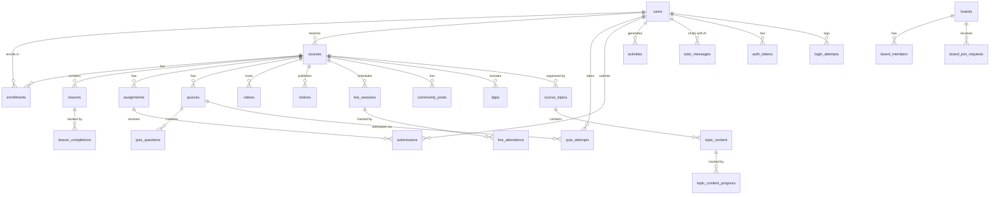

# 📘 EduMate — Project Documentation

> **Study Smarter, Together**
> AI-powered study companion for Class 5–10 students across Indian education boards.

---

## Table of Contents

- [1. Project Overview](#1-project-overview)
- [2. Technology Stack](#2-technology-stack)
- [3. Directory Structure](#3-directory-structure)
- [4. Installation & Setup](#4-installation--setup)
- [5. Database Architecture](#5-database-architecture)
- [6. Authentication & Security](#6-authentication--security)
- [7. Role-Based Access Control](#7-role-based-access-control)
- [8. Module Reference](#8-module-reference)
  - [8.1 Landing Page](#81-landing-page)
  - [8.2 Student Portal](#82-student-portal)
  - [8.3 Teacher Portal](#83-teacher-portal)
  - [8.4 Admin Panel](#84-admin-panel)
  - [8.5 AI Engine](#85-ai-engine)
  - [8.6 Auth Module (Social Platform)](#86-auth-module-social-platform)
  - [8.7 API Endpoints](#87-api-endpoints)
- [9. File Upload System](#9-file-upload-system)
- [10. Database Migration & Seeding](#10-database-migration--seeding)
- [11. Frontend Architecture](#11-frontend-architecture)
- [12. Configuration Reference](#12-configuration-reference)
- [13. Scripts & Utilities](#13-scripts--utilities)

---

## 1. Project Overview

**EduMate** is a full-stack PHP web application designed as an educational platform for Indian secondary school students (Class 5–10). It combines traditional Learning Management System (LMS) features with AI-powered tutoring, collaborative study tools, and gamification elements.

### Key Capabilities

| Feature | Description |
|---------|-------------|
| **Multi-Board Support** | CBSE, ICSE, WBBSE, Maharashtra State Board |
| **AI Tutor** | Gemini-powered doubt solver with image analysis |
| **AI Flashcards** | Auto-generated, high-rigor revision cards |
| **Course Management** | Full LMS with lessons, videos, quizzes, assignments |
| **Live Classes** | Real-time session hosting with join codes |
| **Gamification** | Streak tracking, XP system, Pomodoro focus timer |
| **Study Rooms** | Collaborative learning spaces |
| **Social Platform** | Profiles, friends, messages, repositories, code editor |
| **Role-Based Dashboards** | Separate portals for Students, Teachers, and Admins |

### Target Audience

- **Students**: Class 5–10 across CBSE, ICSE, WBBSE, and Maharashtra boards
- **Teachers**: Educators managing courses, quizzes, assignments, and live sessions
- **Administrators**: Platform managers overseeing users, security, and system health

---

## 2. Technology Stack

| Layer | Technology |
|-------|-----------|
| **Backend** | PHP 8.1+ (procedural, `strict_types`) |
| **Database** | MySQL / MariaDB (InnoDB, utf8mb4) |
| **Server** | XAMPP (Apache + MySQL) |
| **Frontend** | Vanilla HTML5, CSS3, JavaScript (ES6+) |
| **Fonts** | Google Fonts — Poppins, Bodoni Moda |
| **Icons** | Font Awesome 6.4, Ionicons |
| **AI** | Google Gemini API (2.5-flash / 2.0-flash / 2.5-pro) |
| **Email** | PHPMailer (for password reset flows) |
| **Design** | Dark mode support, glassmorphism, micro-animations |

---

## 3. Directory Structure

```
eduMate/
├── index.php                 # Landing page (public)
├── login.php                 # Login page + backend logic
├── register.php              # Registration page + backend logic
├── logout.php                # Session termination
├── style.css                 # Global stylesheet (~180KB)
├── script.js                 # Global JavaScript (~60KB)
├── database.sql              # Full schema dump (production)
│
├── config/
│   └── db.php                # DB connection (PDO) + AI API key
│
├── includes/
│   ├── auth.php              # Session, CSRF, login/logout, role guards, streaks
│   ├── dashboard.php         # Shared dashboard layout (sidebar, topbar, footer)
│   ├── permissions.php       # Ownership & RBAC helpers
│   ├── ai_functions.php      # Gemini API caller + Markdown parser
│   └── uploads.php           # File upload handler (video/image/file)
│
├── student/                  # Student-only pages (19 files)
│   ├── dashboard.php         # Student overview
│   ├── courses.php           # Enrolled courses list
│   ├── course.php            # Single course detail view
│   ├── subjects.php          # Subjects hub (board-filtered)
│   ├── boards.php            # Boards directory
│   ├── quizzes.php           # Quiz listing
│   ├── quiz_result.php       # Quiz result review
│   ├── assignments.php       # Assignment listing + submission
│   ├── videos.php            # Video library
│   ├── live.php              # Live class viewer (join by code)
│   ├── notices.php           # Course announcements
│   ├── progress.php          # Personal progress tracker
│   ├── weekly_report.php     # AI-generated weekly study report
│   ├── ai_tutor.php          # AI doubt solver chat interface
│   ├── ai_suggestions.php    # AI-powered study suggestions
│   ├── flashcards.php        # AI-generated flashcard decks
│   ├── tutor.php             # Legacy tutor interface
│   ├── profile.php           # Student profile page
│   └── enroll.php            # Course enrollment handler
│
├── teacher/                  # Teacher-only pages (13 files)
│   ├── dashboard.php         # Teacher overview
│   ├── courses.php           # Course listing
│   ├── course_edit.php       # Course CRUD editor
│   ├── curriculum.php        # Board & subject management
│   ├── classes.php           # Class management
│   ├── assignments.php       # Assignment CRUD
│   ├── quizzes.php           # Quiz listing
│   ├── quiz_edit.php         # Quiz builder with questions
│   ├── videos.php            # Video upload & management
│   ├── live.php              # Live class hosting (create/start/end)
│   ├── notices.php           # Notice/announcement publisher
│   ├── analytics.php         # Student performance analytics
│   └── profile.php           # Teacher profile page
│
├── admin/                    # Admin-only pages (6 files)
│   ├── dashboard.php         # System overview (stats, trends)
│   ├── users.php             # User management (CRUD, role change)
│   ├── security.php          # Login attempt logs, threat monitoring
│   ├── database.php          # DB health, table stats
│   ├── settings.php          # System configuration
│   └── profile.php           # Admin profile page
│
├── auth/                     # Social/extended auth platform (29+ files)
│   ├── dashboard.php         # Extended user dashboard
│   ├── profile.php           # Rich profile page
│   ├── settings.php          # Account settings
│   ├── friends.php           # Friend system
│   ├── messages.php          # Messaging system
│   ├── notifications.php     # Notification center
│   ├── collaborations.php    # Collaboration features
│   ├── repo.php              # Repository system
│   ├── repo_view.php         # Repository viewer
│   ├── code_editor.php       # In-browser code editor
│   ├── all_repos.php         # Repository browser
│   ├── analytics.php         # User analytics
│   ├── forgot_password.php   # Password reset (PHPMailer)
│   ├── tac.php               # Terms and conditions
│   └── ... (14 more files)
│
├── api/                      # AJAX API endpoints
│   ├── ai_tutor.php          # AI Tutor chat API (ask, quiz, timetable, history)
│   └── ai_flashcards.php     # AI Flashcard generation API
│
├── scripts/                  # Dev & maintenance utilities
│   ├── migrate.php           # v1 schema migrations
│   ├── migrate_v2.php        # v2 schema migrations
│   ├── schema_v2.sql         # v2 DDL statements
│   ├── seed.php              # Demo data seeder
│   ├── create_admin.php      # Admin account creator
│   ├── e2e_test.php          # End-to-end test runner
│   ├── smoke_check.php       # Quick health check
│   └── check_live.php        # Live session status checker
│
├── assets/
│   ├── css/                  # Additional stylesheets
│   ├── js/                   # Additional scripts
│   ├── img/                  # Static images
│   └── uploads/              # Asset uploads
│
├── uploads/                  # User-uploaded content
│   └── avatars/              # Profile pictures
│
└── favicon_io/               # Favicon assets + web manifest
```

---

## 4. Installation & Setup

### Prerequisites

| Requirement | Minimum Version |
|-------------|----------------|
| PHP | 8.1+ |
| MySQL / MariaDB | 5.7+ / 10.3+ |
| XAMPP | 8.x |
| cURL extension | Enabled (for AI API) |
| fileinfo extension | Enabled (for uploads) |

### Step-by-Step Installation

**1. Clone / Copy the project**
```
Place the `eduMate` folder inside your XAMPP htdocs directory:
C:\xampp\htdocs\WEBPAGE\eduMate\
```

**2. Start XAMPP Services**
- Open XAMPP Control Panel
- Start **Apache** and **MySQL**

**3. Database Setup (automatic)**

The application auto-creates the `edumate` database on first run if MySQL is reachable. Alternatively, import the schema manually:

```sql
-- Via phpMyAdmin or MySQL CLI:
SOURCE C:/xampp/htdocs/WEBPAGE/eduMate/database.sql;
```

**4. Run Migrations (if upgrading)**
```
Browse to: http://localhost/WEBPAGE/eduMate/scripts/migrate.php
Then:      http://localhost/WEBPAGE/eduMate/scripts/migrate_v2.php
```

**5. Seed Demo Data (optional)**
```
Browse to: http://localhost/WEBPAGE/eduMate/scripts/seed.php
```

This creates demo accounts:

| Role | Email | Password |
|------|-------|----------|
| Admin | `admin@edumate.local` | `Admin@12345` |
| Teacher | `ananya.rao@edumate.local` | `Teacher@123` |
| Teacher | `vikram.iyer@edumate.local` | `Teacher@123` |
| Student | `subhrajit@edumate.local` | `Student@123` |

**6. Configure AI (optional)**

Edit [db.php](file:///c:/xampp/htdocs/WEBPAGE/eduMate/config/db.php) and set `AI_API_KEY` to a valid Google Gemini API key:
```php
const AI_API_KEY = 'your-gemini-api-key-here';
```

**7. Access the Application**
```
http://localhost/WEBPAGE/eduMate/
```

---

## 5. Database Architecture

The application uses **30+ tables** organized into the following domains:

### Entity-Relationship Overview



### Core Tables Reference

| Table | Purpose | Key Relationships |
|-------|---------|-------------------|
| `users` | User accounts (all roles) | Central entity; FK target for most tables |
| `courses` | Course definitions | Linked to `teacher_id`, `creator_id` |
| `enrollments` | Student-course enrollment | Bridges `users` ↔ `courses` |
| `lessons` | Course content units | Belongs to `courses` |
| `lesson_completions` | Lesson progress tracking | Bridges `users` ↔ `lessons` |
| `quizzes` | Quiz definitions | Belongs to `courses` (nullable for AI quizzes) |
| `quiz_questions` | MCQ questions (4 options) | Belongs to `quizzes` |
| `quiz_attempts` | Student quiz results | Bridges `users` ↔ `quizzes` |
| `quiz_attempt_details` | Per-question responses | Belongs to `quiz_attempts` |
| `assignments` | Teacher-created tasks | Belongs to `courses` + `teacher_id` |
| `submissions` | Student assignment submissions | Bridges `users` ↔ `assignments` |
| `videos` | Video library entries | Optional FK to `courses`, `teacher_id`, `uploader_id` |
| `notices` | Course announcements | Belongs to `courses` |
| `notice_replies` | Replies to notices | Belongs to `notices` |
| `notice_acknowledgements` | Notice read receipts | Bridges `users` ↔ `notices` |
| `boards` | Educational board entities | Has members, join requests |
| `board_members` | Board membership | Bridges `users` ↔ `boards` |
| `board_join_requests` | Board membership requests | Bridges `users` ↔ `boards` |
| `course_subjects` | Subject definitions per board/class | Scoped by `board` + `class` |
| `course_topics` | Topic organization within courses | Belongs to `courses` |
| `topic_content` | Content items within topics | Belongs to `course_topics` |
| `topic_content_progress` | Topic content completion | Bridges `users` ↔ `topic_content` |
| `batches` | Course batches/sections | Belongs to `courses` |
| `chapters` | Batch chapters | Belongs to `batches` |
| `chapter_contents` | Chapter content items | Belongs to `chapters` |
| `live_sessions` | Live class sessions | Belongs to `courses`, hosted by user |
| `live_attendance` | Session attendance tracking | Bridges `users` ↔ `live_sessions` |
| `community_posts` | Course community discussions | Belongs to `courses` |
| `community_replies` | Replies to community posts | Belongs to `community_posts` |
| `dpps` | Daily Practice Problems | Belongs to `courses` |
| `activities` | User activity log | Belongs to `users` |
| `tutor_messages` | AI chat history | Belongs to `users` |
| `ai_doubts` | AI doubt Q&A log | Belongs to `users` |
| `ai_assignments` | AI-generated assignments | Belongs to `users` |
| `ai_timetables` | AI-generated study schedules | Belongs to `users` |
| `video_watch_progress` | Video playback tracking | Bridges `users` ↔ content |
| `auth_tokens` | Remember-me tokens | Belongs to `users` |
| `login_attempts` | Login audit log | Indexed by email + IP |

---

## 6. Authentication & Security

### Session Management

Authentication is handled in [includes/auth.php](file:///c:/xampp/htdocs/WEBPAGE/eduMate/includes/auth.php):

- **Session hardening**: HttpOnly, SameSite=Lax, Secure (when HTTPS)
- **Session regeneration**: ID regenerated on login to prevent fixation attacks
- **Auto-start**: Sessions initialize automatically when auth.php is included

### CSRF Protection

Every form includes a CSRF token:

```php
// Generate hidden field in forms:
echo csrf_field();

// Validate on POST:
if (!csrf_check($_POST['csrf_token'] ?? null)) {
    // Reject request
}
```

- Token: 64-character hex string from `random_bytes(32)`
- Stored in `$_SESSION['csrf_token']`
- Validated via `hash_equals()` for timing-attack resistance

### Password Security

- **Hashing**: `password_hash()` with `PASSWORD_DEFAULT` (bcrypt)
- **Auto-rehash**: Passwords are re-hashed on login if the cost factor has changed
- **Validation rules** (registration):
  - Minimum 8 characters
  - At least one uppercase letter
  - At least one lowercase letter
  - At least one digit

### Login Throttling

- **Limit**: 5 failed attempts per email within a 15-minute window
- **Storage**: `login_attempts` table with email, IP, timestamp, success flag
- **Lookup**: SQL count of failed attempts within the time window

### Remember Me Tokens

- **Selector/Validator pattern** (secure split-token approach)
- Selector: 32-char hex (stored plain in DB, used for lookup)
- Validator: 64-char hex (SHA-256 hashed in DB, compared via `hash_equals()`)
- **Expiry**: 30 days
- **Cleanup**: Token deleted from DB on logout

### Upload Security

- MIME type validation via `finfo`
- `.htaccess` auto-generated in upload directories to block script execution
- Random filenames: `bin2hex(random_bytes(8)) + timestamp`
- Path traversal protection in `upload_abs_path()`

---

## 7. Role-Based Access Control

### Role Hierarchy

```
Admin (full access)
  └── Teacher (course management)
       └── Student (learning access)
```

### Permission Functions

Defined in [includes/permissions.php](file:///c:/xampp/htdocs/WEBPAGE/eduMate/includes/permissions.php):

| Function | Purpose |
|----------|---------|
| `is_admin_user()` | Check if current user is admin |
| `is_owner($entity)` | Check if current user created the entity |
| `can_edit($entity)` | Admin or entity owner |
| `can_delete($entity)` | Same as `can_edit` |
| `course_role($courseId)` | Returns role within course (`owner`/`null`) |
| `can_manage_course($courseId)` | Admin or course owner |
| `is_course_member($courseId)` | Enrolled student or course staff |
| `is_board_member($boardId)` | Member of educational board |
| `is_board_owner($boardId)` | Creator of board entity |
| `owner_badge($entity)` | Returns `'you'` / `'admin'` / `'other'` |
| `render_owner_label($entity)` | HTML chip showing creator info |

### Route Guards

```php
// Require any authenticated user:
require_login();

// Require specific role(s):
require_role('student');
require_role('teacher', 'admin');  // Either teacher or admin
```

- Unauthenticated users are redirected to `login.php` with a flash message
- Unauthorized users receive a `403 Forbidden` response

---

## 8. Module Reference

### 8.1 Landing Page

**File**: [index.php](file:///c:/xampp/htdocs/WEBPAGE/eduMate/index.php) (625 lines)

The public-facing homepage includes:

| Section | Description |
|---------|-------------|
| **Hero** | Typewriter animation, study tabs (Flashcards/Study Rooms/Focus) |
| **Study Widget** | Interactive demo: flashcard flip, quiz, Pomodoro timer |
| **Boards** | Cards for ICSE, CBSE, WBBSE, Maharashtra Board |
| **Features** | Smart Flashcards, Focus Timer, Collaborative Notes |
| **Study Plan Calculator** | Slider-based weekly plan builder |
| **App Download** | Mobile app mockup with phone frame |
| **FAQ** | Searchable, filterable accordion |
| **Footer** | Product/Company/Resources/Legal links |

> [!NOTE]
> Logged-in users are auto-redirected to their role-specific dashboard.

### 8.2 Student Portal

**Location**: [student/](file:///c:/xampp/htdocs/WEBPAGE/eduMate/student/) (19 pages)

**Guard**: `require_role('student')`

| Page | File | Features |
|------|------|----------|
| Overview | `dashboard.php` | Stats cards, enrolled courses, recent activity, streak display |
| Boards | `boards.php` | Browse educational boards directory |
| Subjects Hub | `subjects.php` | Board-filtered subjects |
| My Courses | `courses.php` | Enrolled courses with progress |
| Course Detail | `course.php` | Lessons, videos, community, progress |
| Quizzes | `quizzes.php` | Available quizzes by course |
| Quiz Result | `quiz_result.php` | Score review, per-question breakdown |
| Assignments | `assignments.php` | Active assignments + submission |
| Videos | `videos.php` | Video library browser |
| Live Classes | `live.php` | Join live sessions via code |
| Notices | `notices.php` | Course announcements with acknowledgement |
| My Progress | `progress.php` | Personal analytics dashboard |
| Weekly Report | `weekly_report.php` | AI-generated weekly study summary |
| AI Tutor | `ai_tutor.php` | Chat-based doubt solving |
| AI Suggestions | `ai_suggestions.php` | Personalized study recommendations |
| AI Flashcards | `flashcards.php` | Generate flashcard decks by subject/chapter |
| Profile | `profile.php` | View/edit profile |
| Enroll | `enroll.php` | Course enrollment handler |

**Navigation structure** (defined in [includes/dashboard.php](file:///c:/xampp/htdocs/WEBPAGE/eduMate/includes/dashboard.php)):
- **Learn** group: Overview, Boards, Subjects, Courses, Live, Notices, Quizzes, Assignments, Videos, Progress, Weekly Report
- **AI Tools** group: AI Suggestions, AI Tutor, AI Flashcards

### 8.3 Teacher Portal

**Location**: [teacher/](file:///c:/xampp/htdocs/WEBPAGE/eduMate/teacher/) (13 pages)

**Guard**: `require_role('teacher')`

| Page | File | Features |
|------|------|----------|
| Overview | `dashboard.php` | Course count, enrolled students, assignments, submissions |
| Boards | Via `../student/boards.php` | Shared boards directory |
| My Classes | `classes.php` | Class management |
| Courses | `courses.php` | Course listing with management |
| Course Editor | `course_edit.php` | Full CRUD for courses |
| Boards & Subjects | `curriculum.php` | Board and subject administration |
| Assignments | `assignments.php` | Create/edit/grade assignments |
| Quizzes | `quizzes.php` | Quiz listing |
| Quiz Builder | `quiz_edit.php` | Create quizzes with MCQ questions |
| Videos | `videos.php` | Video upload and management |
| Live Classes | `live.php` | Create/start/end live sessions |
| Notices | `notices.php` | Publish announcements |
| Analytics | `analytics.php` | Student performance data |
| Profile | `profile.php` | Teacher profile page |

**Navigation structure**:
- **Teach** group: Overview, Boards, Classes, Courses, Boards & Subjects, Assignments, Quizzes, Live, Notices
- **Insights** group: Analytics
- **Library** group: Video Library

### 8.4 Admin Panel

**Location**: [admin/](file:///c:/xampp/htdocs/WEBPAGE/eduMate/admin/) (6 pages)

**Guard**: `require_role('admin')`

| Page | File | Features |
|------|------|----------|
| Overview | `dashboard.php` | Total users/courses/enrollments, login trend chart, recent users |
| Users | `users.php` | User CRUD, role management, activation |
| Security | `security.php` | Login attempt monitoring, IP tracking |
| Database | `database.php` | Table stats, DB health |
| Settings | `settings.php` | System configuration |
| Profile | `profile.php` | Admin profile |

**Dashboard metrics** include:
- Total users (breakdown: students, teachers, admins)
- Total courses, enrollments
- Successful logins, quiz attempts, videos uploaded
- AI tutor messages count
- 7-day login trend chart

### 8.5 AI Engine

**Location**: [includes/ai_functions.php](file:///c:/xampp/htdocs/WEBPAGE/eduMate/includes/ai_functions.php)

#### Gemini API Integration & Higher Models

```php
function call_gemini_api(
    array $messages,
    ?string $systemPrompt = null,
    ?string $model = null
): string
```

**Supported Higher Models**:
- `gemini-3.6-flash`: High-intelligence reasoning model with deep step-by-step logic (Recommended default).
- `gemini-3.8-flash`: Cutting-edge next-generation flagship architecture with superior speed and comprehension.
- `gemini-3.5-flash`: High-precision balanced model for assignments, essays, and thorough revision.
- `gemini-3.1-pro-preview`: Pro-tier reasoning for competitive exams, Olympiad math, and advanced STEM.
- `gemini-3-flash-preview`: Fast 3.0 multimodal reasoning model.
- `gemini-2.5-flash`: Proven legacy standard workhorse fallback.

**Intelligent Fallback Cascade**: If any model experiences a quota limit (HTTP 429), high demand surge (HTTP 503), or deprecation, the engine automatically cascades through higher models in sequence:
`$requestedModel` → `gemini-3.6-flash` → `gemini-3.5-flash` → `gemini-3-flash-preview` → `gemini-3.8-flash` → `gemini-3.1-pro-preview` → `gemini-2.5-flash`

**Retry Logic**: 3 attempts with exponential backoff (1s, 2s delays) across all models

**Configuration**:
- Default Model: Set via `AI_MODEL` in `config/db.php` or `ai_model` in `config/site.json` (Admin Settings).
- Real-time Selection: Dynamic in-app model pickers in AI Tutor and AI Flashcards with persistent `localStorage`.
- Temperature: `0.2` (deterministic/factual responses)
- Max output tokens: `8192`
- SSL verify: disabled (development environment)
- IPv4 forced resolution


#### System Prompts

**AI Tutor** (`AI_SYSTEM_PROMPT`):
- Advanced AI Tutor for Class 5–10 students
- Multimodal doubt solver (text + image analysis)
- Interactive quiz generation (`json-quiz` format)
- Study timetable creation (Markdown tables)
- Cognitive support and burnout prevention

**AI Flashcard Generator** (`AI_FLASHCARD_SYSTEM_PROMPT`):
- Senior Board Paper Setter persona
- Generates exactly 15 high-rigor flashcards per deck
- HOTS (Higher-Order Thinking Skills) questions
- LaTeX formula support via `equation-box` divs
- JSON array output with `front`/`back` keys

#### Markdown Parser

`parse_markdown_to_html()` converts AI responses to HTML:
- Bold, italic, inline code
- Headings (h3, h4)
- Unordered lists
- Code blocks (styled as dark theme)
- Markdown tables (responsive with scrolling)
- `json-quiz` blocks preserved for frontend parsing
- XSS protection via `htmlspecialchars()` before Markdown processing

### 8.6 Auth Module (Social Platform)

**Location**: [auth/](file:///c:/xampp/htdocs/WEBPAGE/eduMate/auth/) (29+ files)

This is an extended social/collaboration platform layered on top of the core LMS:

| Feature | File(s) | Description |
|---------|---------|-------------|
| Dashboard | `dashboard.php` | Extended user dashboard with social features |
| Profile | `profile.php` | Rich profile page with bio, avatar, activity |
| Friends | `friends.php` | Friend request/accept/remove system |
| Messages | `messages.php` | Private messaging system |
| Notifications | `notifications.php` | Real-time notification center |
| Collaborations | `collaborations.php`, `collaboration_response.php` | Collaboration invites and management |
| Repositories | `repo.php`, `repo_view.php`, `all_repos.php` | Code repository system |
| Code Editor | `code_editor.php` | In-browser code editing environment |
| File Sharing | `share_view.php`, `download_repo.php` | File/repo sharing with links |
| Analytics | `analytics.php` | Personal usage analytics |
| Settings | `settings.php` | Account settings management |
| Password Reset | `forgot_password.php` | PHPMailer-based reset flow with CAPTCHA |
| Terms | `tac.php` | Terms and conditions page |
| Tab Manager | `tab_manager.php` | Multi-tab navigation helper |

### 8.7 API Endpoints

**Location**: [api/](file:///c:/xampp/htdocs/WEBPAGE/eduMate/api/)

#### AI Tutor API — [ai_tutor.php](file:///c:/xampp/htdocs/WEBPAGE/eduMate/api/ai_tutor.php)

**Method**: POST (JSON body) | **Auth**: Student role required

| Action | Input | Output |
|--------|-------|--------|
| `ask` | `question` (string), optional `fileData` (base64), `mimeType` | AI response text |
| `quiz` | `topic` (string) | Quiz JSON with questions, options, answers |
| `timetable` | `subjects`, `hours`, etc. | Markdown study timetable |
| `history` | — | Previous chat messages |
| `clear` | — | Clears chat history |

**Features**:
- Class-aware context injection (adapts to student's grade level)
- Multimodal image support (base64 upload for photo-based doubts)
- Auto-migration of required tables on first call

#### AI Flashcards API — [ai_flashcards.php](file:///c:/xampp/htdocs/WEBPAGE/eduMate/api/ai_flashcards.php)

**Method**: POST (JSON body) | **Auth**: Student role required

Generates 15-card flashcard decks based on:
- Board (CBSE, ICSE, etc.)
- Class (5–10)
- Subject
- Chapter/Topic

---

## 9. File Upload System

Defined in [includes/uploads.php](file:///c:/xampp/htdocs/WEBPAGE/eduMate/includes/uploads.php):

### Upload Buckets

| Bucket | Max Size | Allowed MIME Types |
|--------|----------|-------------------|
| `video` | 200 MB | mp4, webm, ogg, quicktime |
| `image` | 8 MB | jpeg, png, gif, webp, svg+xml |
| `file` | 25 MB | pdf, zip, docx, xlsx, pptx, txt, csv, markdown |

### Upload Flow

```
$_FILES input
  → Validate error code
  → Check file size against bucket limit
  → Validate MIME type via finfo
  → Generate random filename
  → Create bucket directory (if needed)
  → Write .htaccess (script execution blocked)
  → Move uploaded file
  → Return result array
```

### Return Format

```php
// Success:
['ok' => true, 'path' => 'uploads/video/abc123_1698000000.mp4', 'name' => 'original.mp4', 'size' => 15000000, 'mime' => 'video/mp4']

// Failure:
['ok' => false, 'error' => 'File too large. Max 200 MB.']
```

### Security Measures

- `.htaccess` auto-generated: blocks PHP, Python, Perl, CGI, shell scripts
- Directory indexes disabled
- Random filenames prevent guessing
- `upload_abs_path()` prevents path traversal attacks

---

## 10. Database Migration & Seeding

### Migration Scripts

| Script | Purpose |
|--------|---------|
| [migrate.php](file:///c:/xampp/htdocs/WEBPAGE/eduMate/scripts/migrate.php) | v1: Adds `class`, `board`, `streak_count`, `last_active_date`, `bio` to users; creates `boards`, `course_subjects`, `dpps`, `notices` tables |
| [migrate_v2.php](file:///c:/xampp/htdocs/WEBPAGE/eduMate/scripts/migrate_v2.php) | v2: Upgrades boards to full entities, adds board membership, course topics, batches, chapters, live sessions, community posts |
| [schema_v2.sql](file:///c:/xampp/htdocs/WEBPAGE/eduMate/scripts/schema_v2.sql) | Raw DDL for v2 schema changes (can be run via phpMyAdmin) |

### Seed Script

[seed.php](file:///c:/xampp/htdocs/WEBPAGE/eduMate/scripts/seed.php):
- Creates 4 demo accounts (admin, 2 teachers, 1 student)
- Seeds boards (CBSE, ICSE, WBBSE, Maharashtra Board, etc.)
- Seeds subjects per board and class
- Creates sample courses, lessons, quizzes with questions
- Creates sample videos and enrollment records
- Generates activity log entries
- **Safe to re-run** (uses `INSERT IGNORE` / `ON DUPLICATE KEY UPDATE`)

---

## 11. Frontend Architecture

### Styling

**Main stylesheet**: [style.css](file:///c:/xampp/htdocs/WEBPAGE/eduMate/style.css) (~180KB)

- CSS custom properties for theming (light/dark mode)
- Glassmorphism effects
- Responsive breakpoints
- Micro-animations and transitions
- Dashboard layout system (sidebar + topbar + content area)

### JavaScript

**Main script**: [script.js](file:///c:/xampp/htdocs/WEBPAGE/eduMate/script.js) (~60KB)

Key features:
- **Theme toggle**: Light/dark mode with localStorage persistence
- **Typewriter effect**: Hero section animated text
- **Study widget**: Interactive flashcard, quiz, and Pomodoro timer
- **Scroll animations**: Intersection Observer-based reveal effects
- **FAQ filtering**: Real-time search + tag-based filtering
- **Study plan calculator**: Dynamic Pomodoro/XP/streak goal computation
- **Navigation**: Mobile drawer, scroll-to-top button
- **Counter animations**: Number counting on scroll into view

### Dashboard Layout

Rendered by [includes/dashboard.php](file:///c:/xampp/htdocs/WEBPAGE/eduMate/includes/dashboard.php):

```
┌──────────────────────────────────────────┐
│ Topbar (logo, search, profile dropdown)  │
├──────────┬───────────────────────────────┤
│          │                               │
│ Sidebar  │     Content Area              │
│ (nav)    │     (role-specific pages)     │
│          │                               │
├──────────┴───────────────────────────────┤
│ Footer (credits, version)                │
└──────────────────────────────────────────┘
```

Each role has a distinct navigation structure defined in `student_nav()`, `teacher_nav()`, and `admin_nav()`.

### Shared UI Helpers

| Function | Purpose |
|----------|---------|
| `render_dashboard_header()` | Opens the dashboard shell (sidebar, topbar, flash messages) |
| `render_dashboard_footer()` | Closes the dashboard shell, injects JS |
| `user_avatar_gradient()` | Generates consistent gradient colors from user ID |
| `user_initials()` | Extracts 1–2 letter initials from full name |
| `render_owner_label()` | HTML chip showing content creator |

---

## 12. Configuration Reference

### Database Configuration

**File**: [config/db.php](file:///c:/xampp/htdocs/WEBPAGE/eduMate/config/db.php)

| Constant | Default | Description |
|----------|---------|-------------|
| `DB_NAME` | `'edumate'` | Database name |
| `DB_USER` | `'root'` | MySQL username |
| `DB_PASS` | `''` | MySQL password (empty for XAMPP default) |
| `AI_API_KEY` | `'...'` | Google Gemini API key |

### Connection Strategy

The `db()` function tries these candidates in order:

1. `localhost:3306` (named pipe / Unix socket)
2. `127.0.0.1:3306` (TCP)
3. `localhost:3307` (alternate XAMPP port)
4. `127.0.0.1:3307` (alternate TCP)

If the database doesn't exist, it's auto-created with `utf8mb4_unicode_ci` collation.

### PDO Configuration

```php
PDO::ATTR_ERRMODE            => PDO::ERRMODE_EXCEPTION
PDO::ATTR_DEFAULT_FETCH_MODE => PDO::FETCH_ASSOC
PDO::ATTR_EMULATE_PREPARES   => false  // real prepared statements
```

---

## 13. Scripts & Utilities

| Script | Purpose | Usage |
|--------|---------|-------|
| [migrate.php](file:///c:/xampp/htdocs/WEBPAGE/eduMate/scripts/migrate.php) | Run v1 schema migrations | Browser or CLI: `php scripts/migrate.php` |
| [migrate_v2.php](file:///c:/xampp/htdocs/WEBPAGE/eduMate/scripts/migrate_v2.php) | Run v2 schema migrations | Browser or CLI: `php scripts/migrate_v2.php` |
| [seed.php](file:///c:/xampp/htdocs/WEBPAGE/eduMate/scripts/seed.php) | Populate demo data | Browser or CLI: `php scripts/seed.php` |
| [create_admin.php](file:///c:/xampp/htdocs/WEBPAGE/eduMate/scripts/create_admin.php) | Create an admin account | CLI: `php scripts/create_admin.php` |
| [e2e_test.php](file:///c:/xampp/htdocs/WEBPAGE/eduMate/scripts/e2e_test.php) | End-to-end test runner | Browser or CLI |
| [smoke_check.php](file:///c:/xampp/htdocs/WEBPAGE/eduMate/scripts/smoke_check.php) | Quick system health check | Browser |
| [check_live.php](file:///c:/xampp/htdocs/WEBPAGE/eduMate/scripts/check_live.php) | Check live session status | Browser or CLI |

> [!WARNING]
> **Delete or restrict access to scripts/ in production!** These files contain admin-level operations and should never be publicly accessible on a live server.

---

> **Generated**: October 22, 2026
> **Version**: EduMate v2.0
> **Author**: Documentation auto-generated from source analysis
